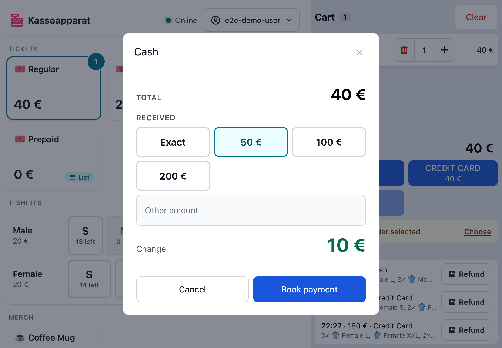

# Kasseapparat: User Documentation

Kasseapparat is a point of sale and guestlist system for demoparties. It is heavily inspired by Partymeister.

It is separated in a [POS](#pos) and an [admin](#admin) part.

You will need the same credentials for both parts.

## Credentials

Kasseapparat uses your event's central Identity Provider (Single Sign-On) for authentication. There are no separate passwords managed within Kasseapparat itself.

### How to log in

When you access the Kasseapparat URL, you will either be authenticated automatically or redirected to your event's central login page. Log in using your standard event or crew credentials.

## <a name="pos">POS</a>

The POS is made for a touch screen, typically an iPad in landscape.

The screen has three parts:

- **The header** with the connection indicator and the user menu. The dot turns orange when the server answers slowly and red when it cannot be reached. The user menu (tap your name) links to the admin and to this manual, switches between dark and light mode, chooses the card reader (when SumUp is enabled) and, depending on your event's setup, logs you out.
- **The products** on the left, grouped in sections such as "Tickets", "T-Shirts" and "Merch".
- **The cart** on the right, with the total and the payment buttons at the bottom and the last purchases below.

### Products

Tap a product to add one unit to the cart; a badge on the card shows how many are in the cart already. For products with a limited stock, the card shows how many are left (orange when only a few are left).

A product that is **sold out** stays visible with "Sold out". Tapping it asks whether the customer is interested anyway; the admin counts these requests, so you know what to restock.

Variants of one article, such as the sizes of a T-shirt, form a **row** in a box: the name of the group ("Male", "Female") and its price on the left, one button per size on the right. Tap a size to add it. A sold-out size is struck through.

Products marked "List" have a guest list (see below).

### Guest list

Products with a guest list open a window with the persons on that list. Tap "Check in" next to a person to add them to the cart, or "+1", "+2" … if they bring additional guests. Persons already in the cart are marked "In cart". A person with an arrival note is marked "Arrival note"; after the check-in the note opens inside their card and has to be confirmed with "Got it".

On the left side of the window you search for persons with the letters A to Z, a space and a key to delete the last character; the x in the search field clears it. The search ignores umlauts and accents, so "MULLER" also finds "Müller".

In very rare circumstances you may add an entry without a selected person using "Sell without list entry".

Close the window with the x in the top right corner or by tapping outside of it.

#### Scanning tickets

For lists with ticket codes (e.g. presale tickets) you can use a barcode scanner that is connected to the iPad as a keyboard. The scanner types into the search field, so it only works while that field has the focus: the window then shows "Ready to scan". If it shows "Not ready to scan – tap here first", tap that line.

A scanned code that belongs to exactly one ticket is added to the cart right away, and the window stays open for the next scan. It does not matter whether the scanner sends an Enter after the code. A ticket that allows additional guests is not added automatically: choose "Check in", "+1" … yourself. A ticket that is already in the cart is not added a second time.

Neither the products nor the guest lists can be modified in the POS. This needs to be done in the [admin](#admin).

### Cart

The cart shows what the current customer has ordered, the newest line on top. Use "+" and "−" to change the quantity; at a quantity of one, "−" becomes a bin that removes the line. Guest list entries can only be removed as a whole.

"Clear" empties the cart. For a few seconds a message offers "Undo", in case it was a mistake.

When the order is complete, press the button of the payment method. Afterwards the cart is empty again and the purchase is shown under the last purchases.

#### Cash

For cash, a dialog asks how much the customer handed over before the payment is booked. "Exact" is preselected, so an exact payment needs just one more tap on "Book payment". Tap the bank note you received (the dialog suggests the next round amounts, e.g. 40 €, 50 €, 100 € for a total of 37 €) or type another amount, and the change is shown in large digits. "Cancel" closes the dialog without booking. A cart that costs nothing (e.g. only free guest list tickets) is booked right away, without the dialog.

#### Card (SumUp)

For card payments the amount is sent to the card reader, and a dialog shows the amount and the elapsed time until the customer has paid. "Cancel payment" stops it. Problems, for example a lost connection to the terminal, are shown in the dialog only when they occur.

If card payments cannot work – no card reader selected, or the selected one is offline – the card button is disabled and a line below it says why. Tap that line to choose a card reader for this iPad. As long as no card reader is paired at all, there is no card button; pairing is done in the [admin](#admin).

### Last purchases

Below the cart you see the last purchases with time, items and total. A purchase can be refunded within 15 minutes (admins: at any time); tap the button and confirm. A payment that is still pending can be resumed from here.

For older purchases use the admin.

## <a name="admin">Admin</a>

The admin interface is needed to modify the products, manage the users and modify the guestlists. You will need the same credentials as for the POS.

The admin opens with the **dashboard**: revenue, number of purchases and the average purchase at the top, then the sales per product and per payment method and the sales over time. It reloads itself every minute while it is open; the switch at the top turns that off.

The other pages share one layout:

- the menu on the left, where you select what to look at
- the action bar to create an entry, and tools to search or filter
- the list of entries; click an entry to see or change it
- a pagination bar

### Sections

The POS shows products in sections, for example "Tickets", "T-Shirts" and "Merch". Each section starts on a new row with its name as a heading. A section without a name starts a new row without a heading.

To manage sections click on "POS > Sections" in the menu. Sections are ordered by "Pos". Every user can create and change sections; only admins can delete them, and only once no product is left in them.

### Product groups

Variants of one article – typically the sizes of a T-shirt – can be put into a product group. The POS shows a group as one row with a button per variant instead of a card per product.

To manage groups click on "POS > Product groups". A group has a name (shown at the start of the row, e.g. "Male"), a section and a position; groups and single products of a section share one order. Every user can create and change groups; only admins can delete them, and only once no product is left in them.

### Add product

To create a product click on "POS > Products" in the menu, then "+ Create" in the action bar.

You will have to fill out some fields (in multiple tabs):

- Name
  - "Name"
- Pricing
  - "Net Price" (without VAT)
  - "VAT"
  - "Gross price" will be displayed for information
- Layout
  - "Product group" (optional; "None" for a single product)
  - "Variant" (only for a product in a group: the label of its button, e.g. "XL")
  - "Section" (only for a product without a group; the first section is preselected. A product in a group is shown in the section of its group)
  - "Pos" (products will be ordered by this position within their section, simply enter a value that is between the product that should be before and the product that should be after your product)
  - "Hidden" (set this to true and your product will not be shown)
- Stock
  - "Total Stock" (0 for unlimited stock)
  - "Units sold" will be displayed for information
- Sold out
  - "Sold out" (enable to collect information how big the interest is)
  - "Sold-out request count" will be displayed for information
- API
  - "API export" (should be true for visitor, false for merchandise and co. all those with value true will count towards the number of visitors)

Save.

You will need to reload the POS to show your product.

### Disable a product

Big warning sign here: you probably do _not_ want to delete a product once the initial setup was done.

When you do not want a product to be shown in the POS, simply hide it. This can be reverted anytime. Note that a sold-out product does not need to be hidden: it stays visible as "Sold out" and collects the interest of customers.

Simply click on the product you would like to disable, click on the "Hidden" toggle and Save.

Done.

You will need to reload the POS to see the effect.

### Delete purchases

When you need to delete an older purchase -- for whatever reason -- you may use the admin.

Click on "POS > Purchases".

Purchases are ordered by the checkout time. In addition you see what was bought, the cart's value, the payment method and the user that performed the action.

Clicking on the purchase gives some more details.

Once you are really sure, simply click on "Delete" and confirm.

### Add user

Click on "Admin > Users". And "+ Create" in the action bar.

Enter the following information:

- Username
- Email address
- Admin (only available when you are an admin yourself)

Save.

**Note:** Since authentication is handled externally, the user will _not_ receive a password reset email. Please ensure the username and email exactly match their existing central event account.

#### User roles and permissions

Kasseapparat is designed with trust in mind: **we assume that all users act responsibly and cooperatively**. Therefore, most actions in the system can be performed by any logged-in user — regardless of their role.

Only a few **critical or sensitive operations** are restricted to users with admin privileges. These include:

- Changing a user's role (e.g., promoting someone to admin)
- Creating a new user **with** admin rights
- Deleting users
- Deleting a product
- Deleting a product section or a product group
- Deleting a guestlist that was created by someone else
- Deleting a guest entry created by another user

All other actions — such as managing products, creating guestlists, or handling purchases — are available to all users.

This lightweight role concept allows for flexibility and autonomy while protecting essential system integrity.

### Product list and interest

The product list shows the stock of every product: "2 / 5 left" for products with a limited stock, the units sold for unlimited ones, and how many customers asked for a sold-out product. "POS > Product interests" lists every single request, with a summary per product next to it.

### Add a user to the guestlist

This is probably a two step process, as the list entries are organized in separate guest lists.

#### Create the guestlist

(In case you already added a guestlist or would like to add a person to an existing guestlist, you may skip this part)

Please, create a guestlist for you. It is recommended to follow a naming scheme such as "Guestlist [yourname]".

Click on "Guestlist > Lists". Click on "+ CREATE" in the action bar.

Enter the following information:

- Name (something like "Guestlist [yourname]")
- Type code (probably false, true when the list contains barcodes)
- Product (probably "Free", the associated product)

Save.

The list of guest lists shows for each list how many entries have arrived ("2 / 20 arrived") and how many people that was in total, additional guests included.

#### Add the user to your guestlist

Click on "Guestlist > List Entries". Click on "+ CREATE" in the action bar.

Enter the following information:

- List (the one from the previous step)
- Name (real name of the person)
- Code (leave empty)
- Additional guests (number of additional guests the person is allowed to bring)
- Arrival Note (This message will be presented in the POS, when the user is selected. It is intended for information like "Will receive a Shirt". Refrain from adding funny stuff here.)
- Notify Email (Add your email address here, in case you would like to be informed once the person arrives)

Save.
