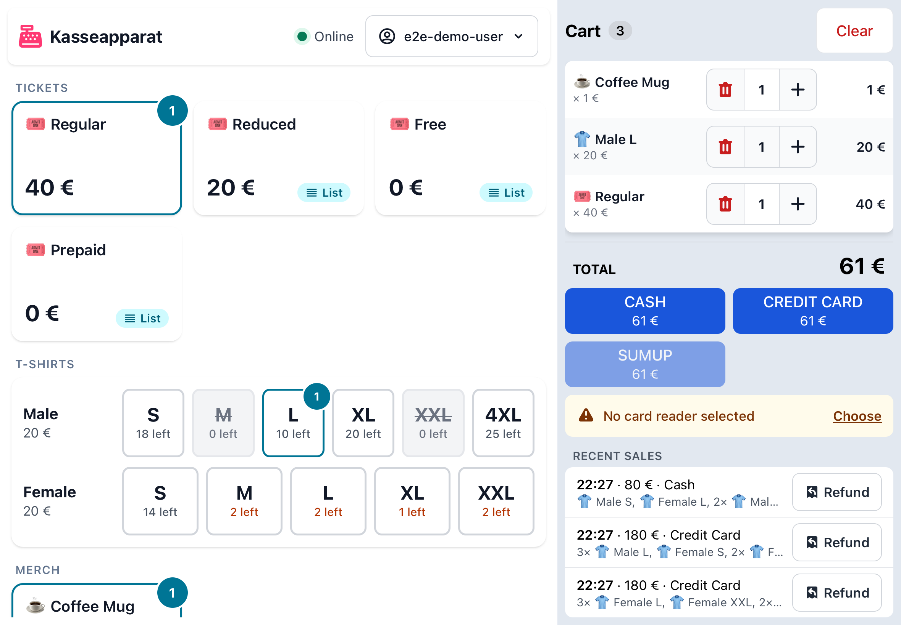
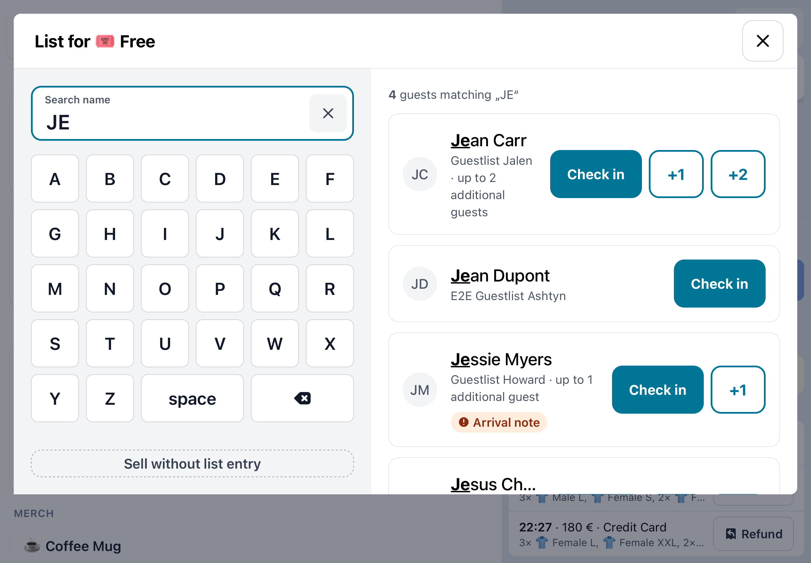
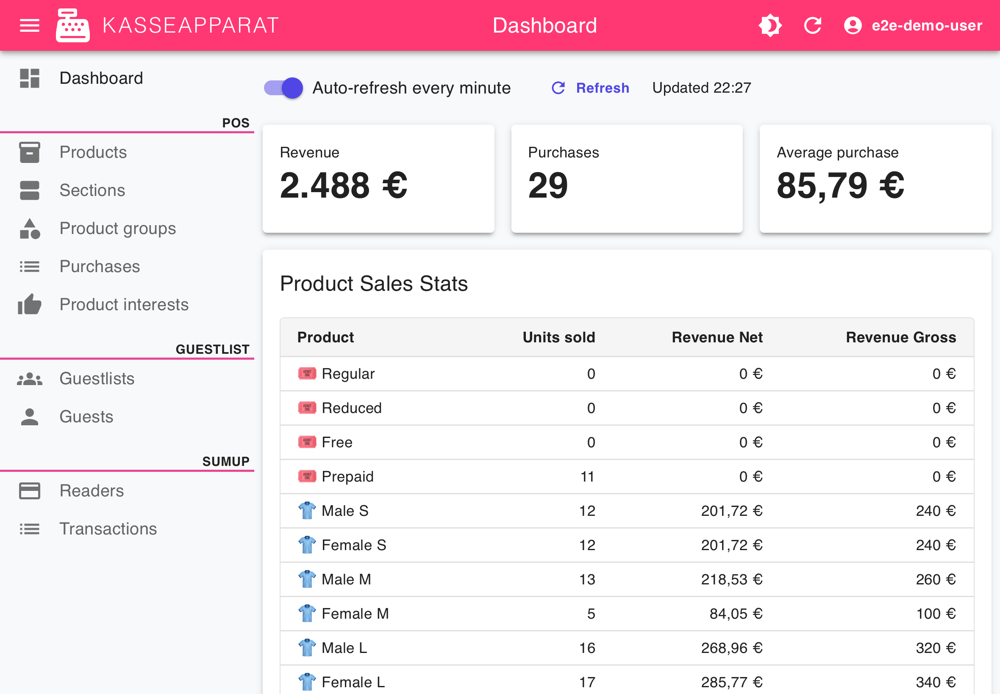

# Kasseapparat: User Documentation

Kasseapparat is a point of sale and guestlist system for demoparties. It is heavily inspired by Partymeister.

It is separated in a [POS](#pos) and an [admin](#admin) part.

You will need the same credentials for both parts.

## Credentials

Kasseapparat uses your event's central Identity Provider (Single Sign-On) for authentication. There are no separate passwords managed within Kasseapparat itself.

### How to log in

When you access the Kasseapparat URL, you will either be authenticated automatically or redirected to your event's central login page. Log in using your standard event or crew credentials.

## <a name="pos">POS</a>

The interface consists of four main parts:

- the product list on the left (1)
- the current cart on top right (2)
- the last purchases on lower right (3)
- a small navigation, containing the currently logged in username, a link to the [admin](#admin), and (depending on your event's setup) a logout button (4)

### Product List

_Products with a shopping cart button_ can be added to the cart directly. For each click on the button one more quantity of the selected product is added to the cart.

_Products with a list_ will open an additional window, where you can find a list of persons (1). Tap "Check in" next to a person to add them to the cart, or "+1", "+2" … if they bring additional guests (2). A person with an arrival note is marked "Arrival note"; after the check-in the note opens inside their card and has to be confirmed with "Got it".

On the left side of the window you may search for these people (3). The buttons contain the letters A to Z, a space and a key to delete the last character; the x in the search field clears it. The search ignores umlauts and accents, so "MULLER" also finds "Müller".

In very rare circumstances you may add an entry without a selected person using "Sell without list entry" (4).

#### Scanning tickets

For lists with ticket codes (e.g. presale tickets) you can use a barcode scanner that is connected to the iPad as a keyboard. The scanner types into the search field, so it only works while that field has the focus: the window then shows "Ready to scan". If it shows "Not ready to scan – tap here first", tap that line.

A scanned code that belongs to exactly one ticket is added to the cart right away, and the window stays open for the next scan. It does not matter whether the scanner sends an Enter after the code. A ticket that allows additional guests is not added automatically: choose "Check in", "+1" … yourself. A ticket that is already in the cart is not added a second time.

Closing the window works by clicking outside the window or by clicking the close button (5).

Neither the products nor the guestlist can be modified using the pos interface. This needs to be done in the [admin](#admin).

### Cart

The cart shows what the current customer has ordered.

You may delete the whole cart or remove a certain product from the cart. It is not possible to reduce the amount of a certain product (to keep it simple). This action is performed without confirmation.

When the order is complete, press the button of the payment method. Afterwards the cart is empty again and the purchase is shown under the "last purchases" below.

For cash, a dialog asks how much the customer handed over before the payment is booked. "Exact" is preselected, so an exact payment needs just one more tap on "Book payment". Tap the bank note you received (the dialog suggests the next round amounts, e.g. 40 €, 50 €, 100 € for a total of 37 €) or type another amount, and the change is shown in large digits. "Cancel" closes the dialog without booking. A cart that costs nothing (e.g. only free guest list tickets) is booked right away, without the dialog.

### Last Purchases

Shows the minimal information (date, total value of purchase) on last purchases.

This allows to revert a previous purchase. Simply click on the button and confirm the dialogue.

To revert previous purchases use the admin, please.

## <a name="admin">Admin</a>

The admin interface is needed to modify the products, manage the users and modify the guestlists. You will need the same credentials as for the POS.

The Interface consists of several areas:

- The menu (1) where you can select the entity to modify
- The action bar (2) to create an entity. Might contain tools to search or filter the entities.
- The list of entities (3) with some basic information. Once you click on an entity, you will see details or an option to modify it
- A pagination bar (4)

### Sections

The POS shows products in sections, for example "Tickets", "T-Shirts" and "Merch". Each section starts on a new row with its name as a heading. A section without a name starts a new row without a heading.

To manage sections click on "POS > Sections" in the menu. Sections are ordered by "Pos". Every user can create and change sections; only admins can delete them, and only once no product is left in them.

### Add product

To create a product click on "POS > Products" in the menu, then "+ Create" in the action bar.

You will have to fill out some fields (in multiple tabs):

- Name
  - "Name"
- Pricing
  - "Net Price" (without VAT)
  - "VAT"
  - "Gross price" will be displayed for information
- Layout
  - "Section" (the section the product is shown in; the first section is preselected)
  - "Pos" (products will be ordered by this position within their section, simply enter a value that is between the product that should be before and the product that should be after your product)
  - "Hidden" (set this to true and your product will not be shown)
- Stock
  - "Total Stock" (0 for unlimited stock)
  - "Units sold" will be displayed for information
- Sold out
  - "Sold out" (enable to collect information how big the interest is)
  - "Sold-out request count" will be displayed for information
- API
  - "API export" (should be true for visitor, false for merchandise and co. all those with value true will count towards the number of visitors)

Save.

You will need to reload the POS to show your product.

### Disable a product

Big warning sign here: you probably do _not_ want to delete a product once the initial setup was done.

When you run out of stock and do not want to a product to be shown in the POS, simply disable it. This can be reverted anytime.

Simply click on the product you would like to disable, click on the "Hidden" toggle and Save.

Done.

You will need to reload the POS to see the effect.

### Delete purchases

When you need to delete an older purchase -- for whatever reason -- you may use the admin.

Click on "POS > Purchases".

Purchases are ordered by the checkout time. In addition you should see the cart's value and the user that performed the action.

Clicking on the purchase gives some more details.

Once you are really sure, simply click on "Delete" and confirm.

### Add user

Click on "Admin > Users". And "+ Create" in the action bar.

Enter the following information:

- Username
- Email address
- Admin (only available when you are an admin yourself)

Save.

**Note:** Since authentication is handled externally, the user will _not_ receive a password reset email. Please ensure the username and email exactly match their existing central event account.

#### User roles and permissions

Kasseapparat is designed with trust in mind: **we assume that all users act responsibly and cooperatively**. Therefore, most actions in the system can be performed by any logged-in user — regardless of their role.

Only a few **critical or sensitive operations** are restricted to users with admin privileges. These include:

- Changing a user's role (e.g., promoting someone to admin)
- Creating a new user **with** admin rights
- Deleting users
- Deleting a product
- Deleting a product section
- Deleting a guestlist that was created by someone else
- Deleting a guest entry created by another user

All other actions — such as managing products, creating guestlists, or handling purchases — are available to all users.

This lightweight role concept allows for flexibility and autonomy while protecting essential system integrity.

### Add a user to the guestlist

This is probably a two step process, as the list entries are organized in separate guest lists.

#### Create the guestlist

(In case you already added a guestlist or would like to add a person to an existing guestlist, you may skip this part)

Please, create a guestlist for you. It is recommended to follow a naming scheme such as "Guestlist [yourname]".

Click on "Guestlist > Lists". Click on "+ CREATE" in the action bar.

Enter the following information:

- Name (something like "Guestlist [yourname]")
- Type code (probably false, true when the list contains barcodes)
- Product (probably "Free", the associated product)

Save.

#### Add the user to your guestlist

Click on "Guestlist > List Entries". Click on "+ CREATE" in the action bar.

Enter the following information:

- List (the one from the previous step)
- Name (real name of the person)
- Code (leave empty)
- Additional guests (number of additional guests the person is allowed to bring)
- Arrival Note (This message will be presented in the POS, when the user is selected. It is intended for information like "Will receive a Shirt". Refrain from adding funny stuff here.)
- Notify Email (Add your email address here, in case you would like to be informed once the person arrives)

Save.
